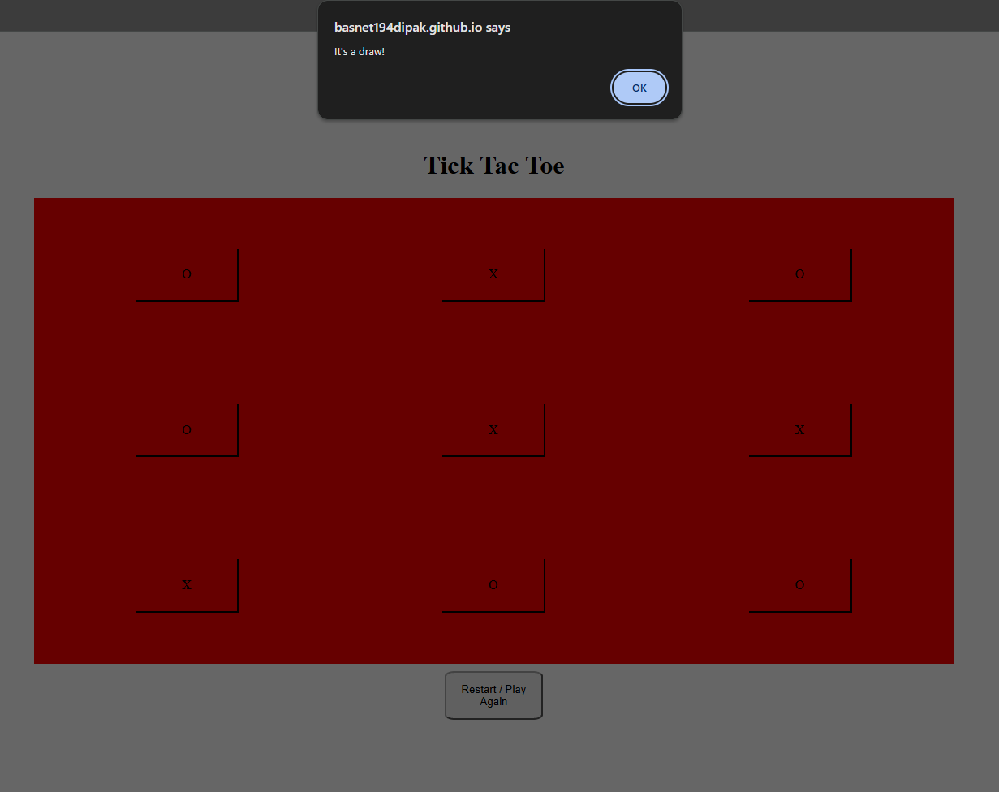

# Tic Tac Toe

A browser-based **Tic Tac Toe game** built using HTML, CSS, and JavaScript. Play against the computer, take turns placing your markers on a 3×3 grid, and see who wins!

## Live Demo

[**Play Tic Tac Toe →**](https://basnet194dipak.github.io/Project-Tic-Tac-Toe/)

## Preview

<!-- Add a screenshot or GIF of your project here -->



<!--  -->

## Features

- **Player vs Computer:** Play against a computer opponent.
- **Interactive Game Board:** A dynamic 3×3 grid for placing markers.
- **Randomized Computer Moves:** The computer randomly selects an available position.
- **Win Detection:** Automatically checks horizontal, vertical, and diagonal winning combinations.
- **Draw Detection:** Detects when all positions are filled without a winner.
- **Restart Functionality:** Restart the game and play again without refreshing the page.
- **Input Validation:** Prevents players from selecting positions that are already occupied.

## Technologies Used

- **HTML5** – Structures the game interface.
- **CSS3** – Styles the game board and layout using CSS Grid and Flexbox.
- **JavaScript (ES6)** – Handles game logic, player moves, computer moves, and win/draw detection.

## How to Run Locally

1. Clone the repository:

    ```bash
    git clone https://github.com/basnet194dipak/Project-Tic-Tac-Toe.git
    ```

2. Navigate to the project directory:

    ```bash
    cd Project-Tic-Tac-Toe
    ```

3. Open `index.html` in your browser.

No additional dependencies or installations are required.

## Project Structure

```text
Project-Tic-Tac-Toe/
├── README.md
├── index.html
├── index.js
└── style.css
```

## What I Practiced

Through this project, I practiced:

- JavaScript constructors and object creation.
- Working with arrays and array methods.
- DOM manipulation and dynamic element creation.
- Handling user interactions with event listeners.
- Implementing game logic and conditional checks.
- Managing game state and restarting an application.
- Using CSS Grid and Flexbox for layout design.

## Future Improvements

- Implement an intelligent computer opponent using the Minimax algorithm.
- Add a score-tracking system.
- Improve the visual design and responsiveness.
- Add player-versus-player functionality.
- Display game results directly in the interface instead of browser alerts.

---

**Built as part of my web development learning journey through The Odin Project.**
